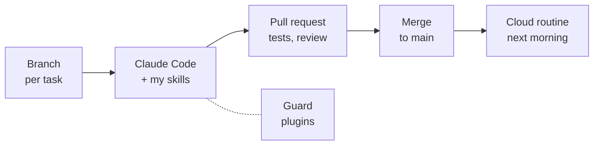

## Hi, I'm Dawn 👋

Backend software engineer in Vancouver, BC. I like systems that stay correct under load.

```java
public class Dawn {

    String role       = "Backend Software Engineer";
    String location   = "Vancouver, BC";
    String experience = "7+ years on high-traffic e-commerce and gaming platforms";

    List<String> focus = List.of(
            "distributed systems", "data consistency", "event-driven design");

    List<String> stack = List.of(
            "Java", "Spring Boot", "Kafka", "MySQL", "Redis",
            "TypeScript", "Angular", "Vue.js");

    // most of my professional code lives in private repositories
    List<String> sideProjects = List.of(
            "ai-trend-digest", "persona-debate-lab", "leetcode",
            "dawnbase", "dawndeck", "Bloomlog");

    String openTo = "Backend and full-stack Software Engineer roles in Canada";
}
```

<p>
  
</p>

### How I use AI and GitHub



- **Claude Code, customized** · 13 skills I built for study, research and note-keeping, plus three plugins with tests: one blocks commits and pushes to `main` and risky deletes, one masks secrets on screen, one shows the current branch above the prompt.
- **Debates before big decisions** · I put real decisions through multi-persona AI debates and keep each persona's record against what happened next, so the next debate casts better. The method is public in [persona-debate-lab](https://github.com/bnivibe/persona-debate-lab).
- **Still solving by hand** · I'm working through LeetCode's Top Interview 150 without AI, Java first, then I critique a Claude solution and port mine to Kotlin, in [leetcode](https://github.com/bnivibe/leetcode).
- **A pull request per change, even solo** · 200+ merged across my own repositories since March 2026.
- **AI on a schedule** · two Claude cloud routines check out a repository and run every morning.
- **Setup in git** · my Claude Code setup lives in a repository, and a bootstrap script restores it on a new machine.

### Public repositories

| Repository | What it is | Built with |
|---|---|---|
| [ai-trend-digest](https://github.com/bnivibe/ai-trend-digest) | Daily AI developer digest. Collects posts from YouTube, Hacker News, Reddit and more, has Claude cluster them into five topics, and posts to Discord every morning. Unattended since September 2026. | Python standard library · 79 tests |
| [persona-debate-lab](https://github.com/bnivibe/persona-debate-lab) | A method for multi-persona AI debates: a 28-persona roster, per-persona scorecards, lessons, and a privacy guard that keeps personal details out of the public repo. | Python · 51 tests · CI checks every commit |
| [leetcode](https://github.com/bnivibe/leetcode) | Top Interview 150, started October 2026. Each problem gets my notes on what I missed and what to practice next. | Java · Kotlin |
| [dawnbase](https://github.com/bnivibe/dawnbase) | Personal knowledge archive. | Next.js · Supabase · Drizzle ORM · Vitest, Playwright |

ai-trend-digest, every morning:


Also building, in private repositories: **dawndeck**, a spaced-repetition learning platform (TypeScript, Next.js, PostgreSQL), and **Bloomlog**, a skincare tracking app for Android (React, TypeScript, Supabase).

### Reach me

[LinkedIn](https://www.linkedin.com/in/bnivibe) · [bnivibe333@gmail.com](mailto:bnivibe333@gmail.com)
