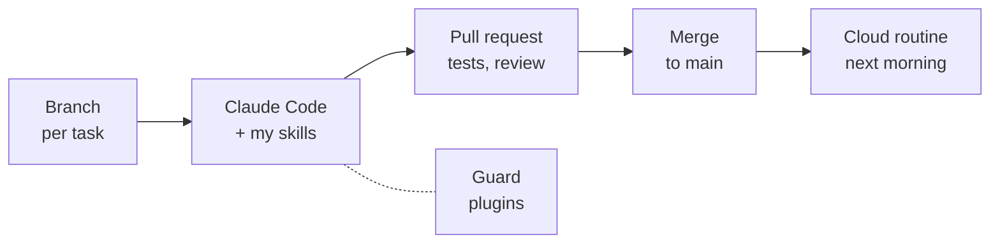
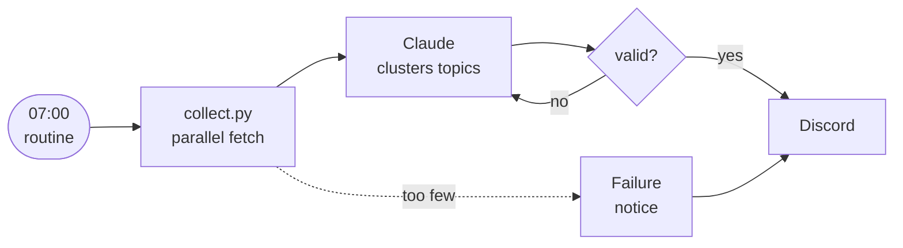
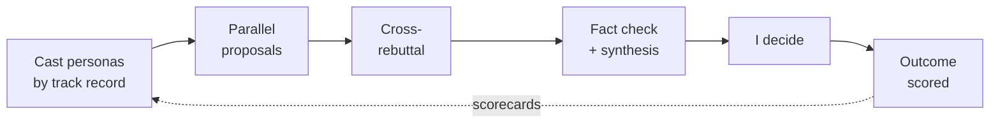
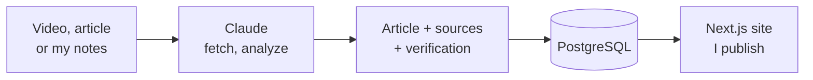
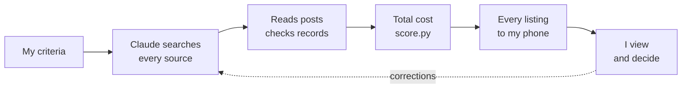
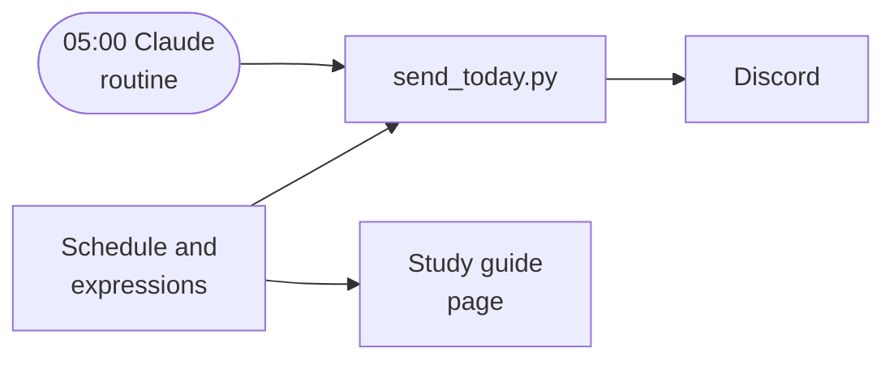
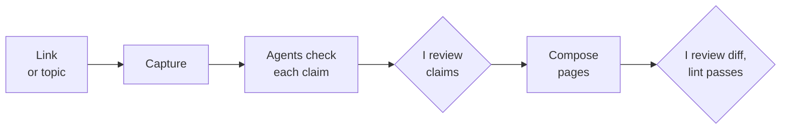
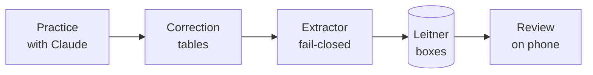

## Hi, I'm Dawn 👋

Backend software engineer in Vancouver, BC. I like systems that stay correct under load.

```java
public class Dawn {

    String role       = "Backend Software Engineer";
    String location   = "Vancouver, BC";
    String experience = "7+ years on high-traffic e-commerce and gaming platforms";

    List<String> focus = List.of(
            "distributed systems", "data consistency", "event-driven design");

    List<String> stack = List.of(
            "Java", "Spring Boot", "Kafka", "MySQL", "Redis",
            "TypeScript", "Angular", "Vue.js");

    // most of my professional code lives in private repositories
    List<String> sideProjects = List.of(
            "ai-trend-digest", "persona-debate-lab", "dawnbase",
            "vancouver-room-hunt", "dawndeck", "Bloomlog");

    String openTo = "Backend and full-stack Software Engineer roles in Canada";
}
```

<p>
  
</p>

### How I use AI and GitHub



- **Claude Code, customized** · 13 skills I built for study, research and note-keeping, plus three plugins with tests: one blocks commits and pushes to `main` and risky deletes, one masks secrets on screen, one shows the current branch above the prompt.
- **Debates before big decisions** · I put real decisions through multi-persona AI debates and keep each persona's record against what happened next, so the next debate casts better. The method is public in [persona-debate-lab](https://github.com/bnivibe/persona-debate-lab).
- **A pull request per change, even solo** · 200+ merged across my own repositories since March 2026.
- **AI on a schedule** · two Claude cloud routines check out a repository and run every morning.
- **Setup in git** · my Claude Code setup lives in a repository, and a bootstrap script restores it on a new machine.

### Public repositories

#### [ai-trend-digest](https://github.com/bnivibe/ai-trend-digest)

A daily AI developer digest, posted to Discord every morning and unattended since September 2026. Code does the collecting and checking; Claude does the judging. `collect.py` pulls the last 24 hours from YouTube, Hacker News, Reddit and more, then a Claude cloud routine ranks the stories several sources agree on, groups them into five topics and writes the summaries. The result is validated against Discord's limits before it is posted, and a failed run posts a notice instead of going silent.

<sub>Python standard library · 79 tests</sub>



#### [persona-debate-lab](https://github.com/bnivibe/persona-debate-lab)

How I argue a decision through before making it. Three to five personas from a 28-person roster, each a Claude subagent with a job and a known bias, propose ideas in parallel, then each attacks the strongest idea that is not its own. The moderator fact-checks every claim and synthesizes. I approve the cast and decide, and when the real outcome is in, each persona's scorecard is updated so the next cast picks better. Transcripts stay private; a privacy guard in the hooks and CI keeps personal details out of the public repo.

<sub>Python · 106 tests · CI checks every commit</sub>



#### [dawnbase](https://github.com/bnivibe/dawnbase)

A personal knowledge archive where Claude writes every article. I hand it a YouTube link, an article or my own notes; Claude fetches and analyzes the source, structures it into an article with its sources and a verification state, tags it and saves it as a draft, and I publish it from the site. When Claude does something unintended while working on the repo, the incident is written up in `docs/guardrails/` and the fix goes into the skill.

<sub>Next.js · Supabase · Drizzle ORM · Vitest, Playwright</sub>



#### [vancouver-room-hunt](https://github.com/bnivibe/vancouver-room-hunt)

How I found a room share in Vancouver as a newcomer with no Canadian credit history. Claude searched every live source on each run, read every post body, checked addresses against BC Assessment and, for finalists, land-title records, and priced each room as rent plus utilities plus the transit its address forces. I sent every message, went to every viewing and signed. Each mistake Claude made became a dated rule in the skill, and the field notes keep the know-how and the experiences behind each one.

<sub>Claude Code skill · Python standard library · 70 tests · CI checks every commit</sub>



### Private repositories

These hold personal data (schedules, study notes, my own setup), so the code stays private. What each one does, and where Claude fits in:

#### claude-config

My Claude Code setup, kept as code: 13 skills, commands, agents, hooks and three tested plugins, restored onto a new machine by one bootstrap script. The skills cover what I do with Claude: research digests, interview and English practice, note-keeping and planning. The plugins are the guardrails behind the workflow diagram above: one denies commits and pushes to `main`, risky deletes and commits without Claude's co-author line; one masks secrets on screen; one shows the current branch above the prompt.

<sub>Python · Shell · TypeScript · 79 merged pull requests</sub>

#### daily-routine

My plan for the day, posted to Discord at 05:00 by a Claude cloud routine. The schedule, the day's English expressions and tongue twisters with their pronunciation all live in the repo as data, and tests keep the schedule consistent, so a date-specific change cannot point at a slot that does not exist. The same data builds a day-by-day study guide page.

<sub>Python standard library · 93 tests</sub>



#### wiki

A knowledge base that Claude maintains, following the LLM-wiki pattern: 34 pages of sources, topics and entities. A link or topic goes through capture, then an investigation in which agents check each claim, then compose. I review the surviving and rejected claims before anything is written, and the diff before it is committed. Originals stay immutable outside the repo, pages point to them, and a lint script must pass before each commit.

<sub>Python · JavaScript · tests for capture and lint</sub>



#### dawndeck

My start page and study app: bookmarks, city cards with local time and weather, and spaced-repetition review of English and CS cards on my phone. Nobody types the cards in. My English practice sessions with Claude end in correction tables, and dawndeck extracts those tables into Leitner cards, skipping any table shape it does not recognize instead of guessing at it.

<sub>TypeScript · Next.js · PostgreSQL · 40 test files · 25 merged pull requests</sub>



Also building: **Bloomlog**, a skincare tracking app for Android (React, TypeScript, Supabase).

### Reach me

[LinkedIn](https://www.linkedin.com/in/bnivibe) · [bnivibe333@gmail.com](mailto:bnivibe333@gmail.com)
