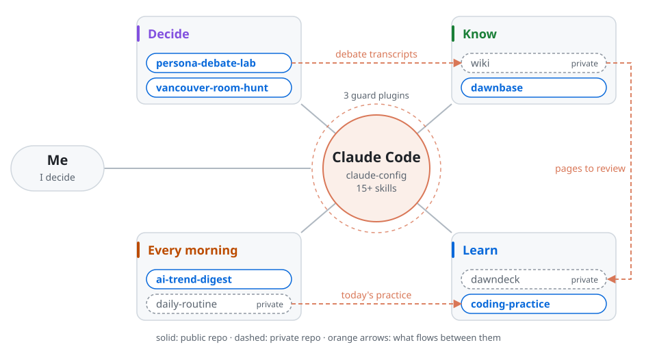

## Dawn Im

I build with Claude Code. It is my assistant in nearly everything I do, and I run it like a backend system: I decide, Claude does the legwork, and guardrails, tests and reviews check both.

**[How I work with AI →](https://github.com/bnivibe/bnivibe/blob/main/how-i-work-with-ai.md)** · **[BNI Tech, my lab: every project and idea since 2011 →](https://bnitech-lab.github.io)**

<picture>
  <source media="(prefers-color-scheme: dark)" srcset="assets/repo-map-dark.svg">
  
</picture>

### Projects

<table>
  <tr>
    <td width="50%" valign="top">
      <b><a href="https://github.com/bnivibe/ai-trend-digest">ai-trend-digest</a></b> 
      A daily AI news digest on Discord, unattended since September 2026. 
      <b>Claude</b> ranks the stories several sources agree on and writes the summaries 
      <b>Me</b> the sources and the taste rules 
      <b>Checked</b> 80+ tests, Discord limit checks, a failure notice 
      <i>Python</i>
    </td>
    <td width="50%" valign="top">
      <b><a href="https://github.com/bnivibe/persona-debate-lab">persona-debate-lab</a></b> 
      Multi-persona AI debates, scored against what really happened. 
      <b>Claude</b> runs the personas, fact-checks, synthesizes 
      <b>Me</b> the cast and the decision 
      <b>Checked</b> scorecards, a privacy guard in CI, 120+ tests 
      <i>Python</i>
    </td>
  </tr>
  <tr>
    <td width="50%" valign="top">
      <b><a href="https://github.com/bnivibe/vancouver-room-hunt">vancouver-room-hunt</a></b> 
      How I found a room in a new city. 
      <b>Claude</b> searched every source, checked public records, priced each room 
      <b>Me</b> every message, viewing and signature 
      <b>Checked</b> a cost script, 70 tests 
      <i>Claude Code skill · Python</i>
    </td>
    <td width="50%" valign="top">
      <b><a href="https://github.com/bnivibe/coding-practice">coding-practice</a></b> 
      Coding problems, solved by hand. 
      <b>Me</b> the solutions, with no AI 
      <b>Claude</b> reads my submissions and drafts the notes 
      <b>Checked</b> the commit history keeps code and notes apart 
      <i>Java · Kotlin</i>
    </td>
  </tr>
  <tr>
    <td width="50%" valign="top">
      <b><a href="https://github.com/bnitech-lab/vancouver-month-2026">vancouver-month-2026</a></b> 
      A small Kotlin game: one month as a newcomer in Vancouver, one action a day. Work in progress. 
      <b>Claude</b> writes the code and the tests 
      <b>Me</b> the idea, every play-through and what changes next 
      <b>Checked</b> 300+ tests, CI on every pull request 
      <i>Kotlin</i>
    </td>
    <td width="50%" valign="top">
      <b>Private, on the same rules</b> 
      <b>claude-config</b> my Claude Code setup: 15+ skills, three tested guard plugins 
      <b>daily-routine</b> a morning plan, with three new expressions from Claude 
      <b>wiki</b> agents check each claim; I review twice before a commit 
      <b>dawnbase</b> my writing desk: Claude drafts each post, only I change its status
    </td>
  </tr>
  <tr>
    <td colspan="2" valign="top">
      <b><a href="https://bnitech-lab.github.io">BNI Tech, my lab</a></b> · <a href="https://github.com/bnitech-lab/bnitech-lab.github.io">source</a> 
      Every project and idea since my first games in 2011, on one page by year and topic. The name comes from those games; it is not a company. 
      <b>Claude</b> builds the page from one data file and keeps each row in step with my records 
      <b>Me</b> every idea, which ones I build, and what stays private 
      <b>Checked</b> a data check, 40+ tests and CI on every pull request; rebuilt every day 
      <i>Python standard library · GitHub Pages</i>
    </td>
  </tr>
</table>

[LinkedIn](https://www.linkedin.com/in/bnivibe) · [bnivibe333@gmail.com](mailto:bnivibe333@gmail.com)
