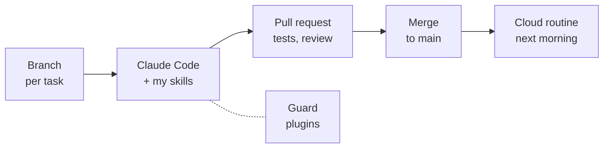
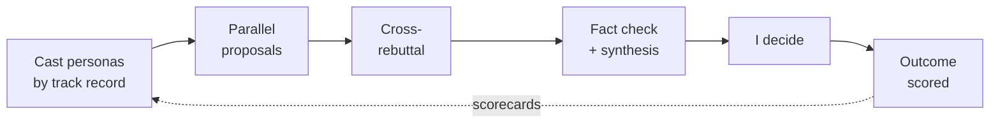
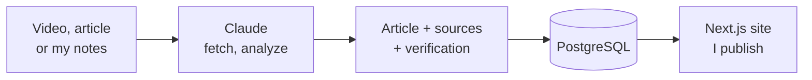

## Hi, I'm Dawn 👋

Backend software engineer in Vancouver, BC. I like systems that stay correct under load.

```java
public class Dawn {

    String role       = "Backend Software Engineer";
    String location   = "Vancouver, BC";
    String experience = "7+ years on high-traffic e-commerce and gaming platforms";

    List<String> focus = List.of(
            "distributed systems", "data consistency", "event-driven design");

    List<String> stack = List.of(
            "Java", "Spring Boot", "Kafka", "MySQL", "Redis",
            "TypeScript", "Angular", "Vue.js");

    // most of my professional code lives in private repositories
    List<String> sideProjects = List.of(
            "ai-trend-digest", "persona-debate-lab", "dawnbase",
            "dawndeck", "Bloomlog");

    String openTo = "Backend and full-stack Software Engineer roles in Canada";
}
```

<p>
  
</p>

### How I use AI and GitHub



- **Claude Code, customized** · 13 skills I built for study, research and note-keeping, plus three plugins with tests: one blocks commits and pushes to `main` and risky deletes, one masks secrets on screen, one shows the current branch above the prompt.
- **Debates before big decisions** · I put real decisions through multi-persona AI debates and keep each persona's record against what happened next, so the next debate casts better. The method is public in [persona-debate-lab](https://github.com/bnivibe/persona-debate-lab).
- **A pull request per change, even solo** · 200+ merged across my own repositories since March 2026.
- **AI on a schedule** · two Claude cloud routines check out a repository and run every morning.
- **Setup in git** · my Claude Code setup lives in a repository, and a bootstrap script restores it on a new machine.

### Public repositories

#### [ai-trend-digest](https://github.com/bnivibe/ai-trend-digest)

A daily AI developer digest, posted to Discord every morning and unattended since September 2026. Code does the collecting and checking; Claude does the judging. `collect.py` pulls the last 24 hours from YouTube, Hacker News, Reddit and more, then a Claude cloud routine ranks the stories several sources agree on, groups them into five topics and writes the summaries. The result is validated against Discord's limits before it is posted, and a failed run posts a notice instead of going silent.

<sub>Python standard library · 79 tests</sub>


#### [persona-debate-lab](https://github.com/bnivibe/persona-debate-lab)

How I argue a decision through before making it. Three to five personas from a 28-person roster, each a Claude subagent with a job and a known bias, propose ideas in parallel, then each attacks the strongest idea that is not its own. The moderator fact-checks every claim and synthesizes. I approve the cast and decide, and when the real outcome is in, each persona's scorecard is updated so the next cast picks better. Transcripts stay private; a privacy guard in the hooks and CI keeps personal details out of the public repo.

<sub>Python · 51 tests · CI checks every commit</sub>



#### [dawnbase](https://github.com/bnivibe/dawnbase)

A personal knowledge archive where Claude writes every article. I hand it a YouTube link, an article or my own notes; Claude fetches and analyzes the source, structures it into an article with its sources and a verification state, tags it and saves it as a draft, and I publish it from the site. When Claude does something unintended while working on the repo, the incident is written up in `docs/guardrails/` and the fix goes into the skill.

<sub>Next.js · Supabase · Drizzle ORM · Vitest, Playwright</sub>



Also building, in private repositories: **dawndeck**, a spaced-repetition learning platform whose English review cards Claude builds from my tutoring notes (TypeScript, Next.js, PostgreSQL), and **Bloomlog**, a skincare tracking app for Android (React, TypeScript, Supabase).

### Reach me

[LinkedIn](https://www.linkedin.com/in/bnivibe) · [bnivibe333@gmail.com](mailto:bnivibe333@gmail.com)
