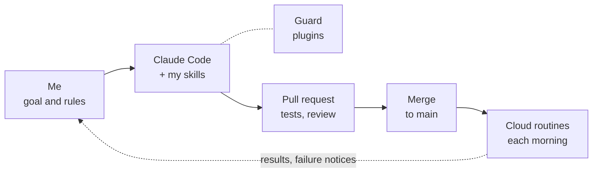

# How I work with AI

I use Claude Code as an assistant in nearly everything I do, not only code: research, study and interview practice, English corrections, planning my day, keeping notes, even finding a room in a new city. Because it touches so much, I run it the way I run a backend system: clear ownership, rules enforced in code, every change checked, failures planned for, and a record of what happened.

[← Back to my profile](https://github.com/bnivibe)

## The loop

I set the goal and the rules. Claude Code does the work with skills I wrote for each kind of task, inside guard plugins that deny unsafe steps. Every change goes through a branch and a pull request with tests, even when I work alone: 300+ merged across my repositories since March 2026. Two Claude cloud routines check out a repository and run every morning, and their results and failure notices come back to me.

## Five rules

### 1. I decide, Claude does the legwork

Claude searches, reads, drafts, tests and writes things up. Anything that speaks for me, signs or pays stays with me: Claude drafts emails and never sends one, and it never deletes a message I received. Some work I keep entirely to myself so that I learn it: I solve coding problems by hand, with no AI.

- **In [vancouver-room-hunt](https://github.com/bnivibe/vancouver-room-hunt):** Claude searched every live source, read every post and checked addresses against public records. I sent every message, went to every viewing and signed.
- **In [persona-debate-lab](https://github.com/bnivibe/persona-debate-lab):** Claude runs the personas, the fact check and the synthesis. I approve the cast and make the decision.

Backend habit: least privilege. Each actor gets the permissions its job needs, and anything with an outside effect waits for a human.

### 2. Guardrails are code, not promises

A rule I care about is enforced by a hook that runs before the command, not by asking nicely in a prompt. Three plugins, each with tests:

- **dawn-guard** denies commits while on `main`, pushes to `main`, recursive deletes outside temp folders, commits without Claude's co-author line (my own coding-practice solutions are the one exception), and any call that would send, forward, delete or trash email. If the hook itself errors, it denies.
- **secret-redact** masks tokens and keys in what the screen draws, so a session can be watched from a phone or shared.
- **branch-band** shows the current repository and branch above the prompt, in red on `main`.

A guard stops accidents; it is not a lock against a model that ignores instructions. That is why rules 3 and 5 exist too.

- **In [persona-debate-lab](https://github.com/bnivibe/persona-debate-lab):** a privacy guard in the git hooks and in CI checks every commit, branch name and tag for personal details before anything goes public.

Backend habit: enforce an invariant in the system, with a constraint or a check, rather than in the documentation.

### 3. Nothing lands unchecked

A branch and a pull request per change, and tests before the merge. For my own tools, Claude merges after tests, lint and the build pass; anything that speaks for me in public waits for my review.

- **In [ai-trend-digest](https://github.com/bnivibe/ai-trend-digest):** Claude's digest is validated against Discord's limits before it is posted, and the code has 79 tests.
- **In wiki** (private): agents check each claim, I review the claims that survived and the ones that did not, then the diff, and a lint script must pass before a commit.

Backend habit: code review and CI, the same as on a team.

### 4. Failure is planned for

Each automated job says what happens when something breaks, before it breaks.

- **In [ai-trend-digest](https://github.com/bnivibe/ai-trend-digest):** a run that collects too few stories posts a failure notice instead of going silent.
- **In daily-routine** (private): if anything fails, a stored list of expressions in the repo takes over from Claude.
- **In dawndeck** (private): the card extractor skips any table shape it does not recognize instead of guessing at it.

Backend habit: timeouts, fallbacks, fail-closed parsing and alerts.

### 5. Every result leaves a record

- **In [coding-practice](https://github.com/bnivibe/coding-practice):** my solutions are committed under my name alone and Claude's notes carry its `Co-Authored-By` line, so the history shows whose work is whose.
- **In [dawnbase](https://github.com/bnivibe/dawnbase):** when Claude does something unintended, the incident is written up in `docs/guardrails/` and the fix goes into the skill.
- **In [persona-debate-lab](https://github.com/bnivibe/persona-debate-lab):** each persona is scored against what actually happened, so the next debate casts better.

Backend habit: audit logs and blameless postmortems.

## Where the setup lives

My Claude Code setup, with 15+ skills, commands, agents, hooks and the three plugins, is a private repository, claude-config, with 100+ merged pull requests. One bootstrap script restores it onto a new machine.
